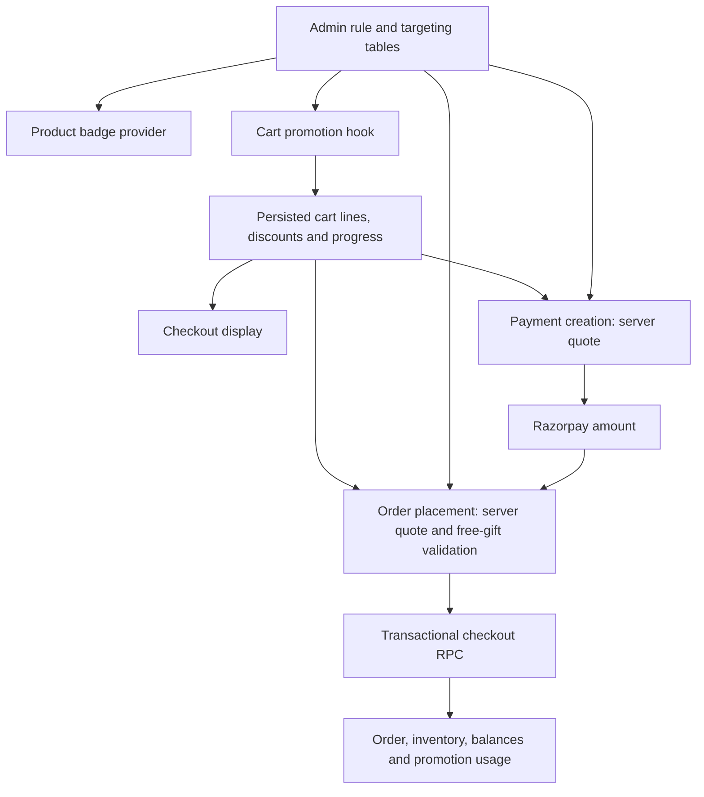

# BXGY and free-gift implementation review — 31 October 2026

Historical review: the repeat-limit and pricing decisions below were superseded on 2 November. Current behavior and deployment requirements are documented in [bxgy-pricing.md](bxgy-pricing.md): repeated free units, optional original-price replacement, and mixed-brand eligibility.

The project has the foundations for automatic promotions, but the cart preview, admin controls, checkout, and order-management flows do not yet share a consistent interpretation of the rules. The strongest next step is to finish one authoritative offer quote and use its results throughout the purchase and refund lifecycle.

This review covers the current working tree, including the uncommitted financial-security changes from 30 October. Git HEAD remains `77b1fdc`. Findings below distinguish live observations, local reproductions, source findings, and proposed business rules. No application code, remote configuration, orders, payments, balances, or notifications were changed during this review.

## Store-owner decisions

The owner selected the following behavior after reviewing the plain-language report:

| Decision | Agreed behavior |
| --- | --- |
| BXGY offer | Add three eligible products and pay for two; the cheapest eligible unit is free |
| Repeat rewards | Maximum one BXGY free unit and one fixed gift per order; neither reward repeats for additional qualifying sets |
| Combining automatic offers | BXGY and a spending-based fixed gift can both apply to the same order when their conditions are met |
| Coupons | Coupons cannot be combined with the automatic offers |
| Gift selection | The store chooses one fixed gift; customers do not choose from a list |
| Spending threshold | Sum the paid basket lines at their current selling prices before the BXGY/basket-offer reduction, excluding delivery charges and added free-gift lines. Two items marked ₹1,000 but selling for ₹800 count as ₹1,600 |

These are the intended store rules, not a claim that the current code already implements them. Separate-product/partial-discount BXGY capabilities discussed later are outside the selected BXGY mode. Fixed gifts and spending thresholds remain relevant to the separate gift-with-purchase feature.

The owner confirmed both automatic offers may apply together and selected selling-price totals for the gift threshold. Ordinary markdowns and active flash-sale prices are therefore reflected in the qualifying basket value; the later BXGY reduction does not lower that value. Credits used for payment do not change the qualifying merchandise amount. Six eligible products still earn only one BXGY free unit, so the customer pays for five, and may additionally receive the one fixed gift if the spending condition is met.

Illustration only: three eligible products selling for ₹800 each produce a qualifying basket value of ₹2,400. Buy 3 Pay for 2 reduces the merchandise payable to ₹1,600. If a fixed-gift campaign has a ₹2,000 threshold, that order also earns the fixed gift. The actual gift, qualifying products, and spending threshold are campaign settings; this example does not configure a live offer. These business decisions have been documented only; application behavior has not yet been updated to enforce them.

## Live configuration

Read-only requests to the Supabase project configured in `.env.local`, authenticated with a verified `service_role` credential, returned:

| Area | Observed state |
| --- | --- |
| `buy_x_get_y` | 0 rules, including inactive rules |
| `free_gifts` | 0 rules, including inactive rules |
| `gift_products` | 0 dedicated inventory records |
| BXGY and free-gift junction tables | All queried tables exist and returned 0 links |
| `flash_sales` | 0 records |
| `checkout_promotion_uses` | REST HEAD returned 404; absent from the service-role OpenAPI definition |
| Catalog sanity check | 858 products visible to the same credential |

There are currently no configured BXGY/free-gift campaigns in this project. The issues below concern the implemented capabilities and what will happen when campaigns are configured. These observations do not establish which application revision the public website is serving.

The new promotion ledger is unavailable through the live Data API. That is consistent with the financial migration remaining unapplied, but an API/schema-exposure problem is another possible cause. Do not treat the new transactional checkout as verified in production. Follow [the financial deployment guide](financial-security-deployment.md) and verify the deployed schema before deploying its dependent code.

The live OpenAPI schema also confirms that `order_items.product_id` is required and references `products.id`. This matters for dedicated gift inventory below.

## What is currently implemented

| Offer type | Configuration and behavior | Current limits |
| --- | --- | --- |
| BXGY: cheapest qualifying item | Match products, categories, or brands; discount the cheapest qualifying units by 100%, a percentage, or a fixed amount | Each set contains `buy_quantity + 1` items. There is no configurable Y quantity |
| BXGY: separate reward product | Automatically add a configured store product at zero price | Uses the same X+1 threshold; percentage/fixed reward settings are ignored |
| Free gift with purchase | Trigger on cart value, or on quantity of selected products/categories/brands; optional qualifying-spend minimum | Adds the configured `gift_quantity` once. Changing `max_per_order` does not implement repeat awards |
| Dedicated gift inventory | Separate gift products with stock, images, brand, active state, and reference price | Order persistence and cancellation do not fully support this inventory source |
| Coupon codes | One applied code in cart; percentage/fixed discounts; product/category targeting; dates and usage restrictions | Combines with automatic offers without an explicit compatibility policy |
| Flash sales and ordinary markdowns | Storefront calculates sale prices and stores them in cart lines | New canonical checkout pricing applies ordinary markdowns but omits flash sales |
| Free shipping | ₹3,000 merchandise subtotal in pincodes 795001 and 795005 | Uses the subtotal before BXGY/coupon reductions; this is a business policy that should be explicit |

Gift-card balances and coins are applied as credits after the offer calculations. Their payment-security implementation is covered in the separate financial review.

Admin entry points are `/admin/bxgy`, `/admin/free-gifts`, `/admin/gift-products`, `/admin/promos`, and the flash-sale management flow. Product badges and cart progress messages advertise eligible campaigns. Promotional gift lines cannot be manually removed through the ordinary cart controls.

### Current data flow

The server quote and transaction shown here belong to the current source changes; their deployment is not confirmed. There is also an older server evaluator in `app/actions/promotions.ts`. No storefront callers of its `evaluateBXGY`/`evaluateFreeGifts` exports were found; the cart uses the hook instead.

The recent financial patch improves the trust boundary: it calculates BXGY amounts from database records and commits stock, balances, orders, and promotion usage together. It does not unify the frontend preview or complete the promotion lifecycle.

## Findings that should be addressed before campaigns launch

### 1. High — dedicated gift inventory cannot reliably become an order item

**Evidence: source plus live schema.** `app/actions/orders.ts:320` chooses `gift_product_id || gift_product_ref_id` as the order item's product ID. For a dedicated-only gift, that is an ID from `gift_products`, but the live `order_items.product_id` foreign key requires an ID from `products`. Unless a matching store product exists, the order insert fails. The form explicitly recommends dedicated gift inventory.

Dedicated gift lines also receive a null `product_variant_id`. Cancellation and deletion restore stock only for non-null variant IDs, so they cannot restore dedicated gift stock. The order line does not retain a separate gift-inventory reference.

**Improve:** choose one supported model: represent every shippable gift as a store variant, or add an explicit `gift_product_id` reference and inventory-source constraint to order items. Preserve the source through placement, cancellation, returns, and deletion. Do not put IDs from two unrelated tables into the same foreign-key column.

Sources: `app/actions/orders.ts:304`, `:329`, `:464`, `:1183`; live service-role OpenAPI schema.

### 2. High — separate-product BXGY has the wrong purchase threshold and ignores its discount settings

**Evidence: locally reproduced and source confirmed.** Both the hook and canonical calculator divide qualifying purchased quantity by `X + 1`, including offers where the reward is added separately.

For “buy 2 eligible products, receive a separate gift”:

| Purchased qualifying quantity | Current reward count | Recommended count for this offer meaning |
| ---: | ---: | ---: |
| 2 | 0 | 1 |
| 3 | 1 | 1 |
| 4 | 1 | 2 |
| 6 | 2 | 3 |

X+1 is appropriate for “put three qualifying units in the basket and pay for two.” A separately added gift needs an explicit purchase/reward model.

The admin also offers percentage/fixed discounts for a specific reward product, but both cart and order placement price that reward at zero. A configured “get this product at 50% off” becomes a free product once the threshold is reached.

**Improve:** separate the two reward modes, add `get_quantity`, and calculate each mode explicitly. Support partial discounts on the reward line or limit this mode to free gifts until partial discounts work. Allow `buy_quantity = 1` in the admin; its current input minimum of 2 prevents ordinary Buy 1 Get 1 creation through the form.

Sources: `lib/checkout-pricing.ts:53`, `:56`, `:126`; `hooks/use-promotions.ts:470`, `:523`; `app/actions/orders.ts:334`; `app/admin/bxgy/bxgy-form.tsx:126`, `:214`.

### 3. High — storefront and checkout can quote different prices and rewards

**Evidence: source confirmed.** The cart uses `applyFlashSaleToPrice`, while the new server quote calls only the regular markdown helper and never reads `flash_sales`. A ₹500 product advertised at ₹400 in a flash sale can therefore be priced at ₹500 by checkout. This also changes BXGY savings and gift-spend eligibility. There are no live flash sales at the time of review, so this is a source gap rather than an observed live charge.

The payment endpoint returns the server's amount, and checkout passes that amount directly to Razorpay without reconciling its displayed total. COD also accepts the newly calculated total without first displaying a revised quote.

Free gifts remain outside payment quotation: the payment endpoint calculates BXGY rewards, but the ordinary free-gift claims are validated only inside `placeOrder`. An unavailable or invalid displayed gift can therefore reject order confirmation after payment capture.

**Improve:** quote markdowns, flash sales, coupons, BXGY, all gift entitlements, shipping, and credits together before payment. Return line details and reasons, update the visible total, and require acknowledgement when the payable amount changes. Keep final stock/eligibility checks transactional. Define whether an unavailable optional gift is removed with a message, substituted, or blocks checkout.

Sources: `app/(store)/cart/page.tsx:41`, `:99`; `lib/checkout-pricing.ts:103`; `app/api/create-order/route.ts:23`; `app/(store)/checkout/checkout-client.tsx:328`; `app/actions/orders.ts:147`.

### 4. High — promotion savings are not allocated to order lines for refunds and edits

**Evidence: source confirmed; no refund was sent.** Cheapest-item BXGY savings are stored at order level, while the affected item retains its full unit price. Partial refund calculates `unit_price × refunded quantity`, without allocating BXGY/coupon savings or accounting for previously consumed credits.

Example: three ₹100 units with one free cost ₹200 before shipping. Refunding all three lines currently calculates ₹300. Razorpay may reject a refund above the remaining captured amount; the manual GPay path lacks that provider-side guard. Individual-unit refunds also lack an agreed allocation policy.

Admin removal and discount-edit functions recompute totals without preserving BXGY, gift-card, and coin reductions. They also do not re-evaluate whether a remaining free gift is still earned.

**Improve:** persist per-line and, where needed, per-unit promotion allocations and the net paid amount. Bound cumulative refunds by the refundable payment/credit allocation. Define the policy for returning qualifying items while retaining a gift. Route order edits through the same pricing rules or explicitly preserve the original promotion contract.

Sources: `app/actions/orders.ts:325`, `:357`, `:558`, `:886`, `:924`.

### 5. High — automatic discounts stack without an explicit merchant policy

**Evidence: locally reproduced and source confirmed.** Each eligible BXGY rule reuses the same purchased quantities. The new calculator caps monetary reductions at the line total, but it does not reserve qualifying units or select a single winning campaign. Four overlapping rules on three ₹100 units produced a ₹300 discount in the local probe. The hook has no corresponding line-total cap and can display an even larger saving.

Coupon percentage discounts are calculated on the merchandise amount before BXGY reduction. Three ₹100 units, a ₹100 BXGY reduction, and a 10% coupon yield ₹170 before shipping. A policy that applies the coupon after BXGY would yield ₹180. Either policy needs an explicit merchant choice and consistent display.

**Improve:** add compatibility classes, priorities/exclusion groups, unit allocation, and a deterministic winner rule. A reasonable initial policy is one automatic product offer per qualifying unit, with coupon stacking allowed only when configured. Confirm whether gift thresholds and shipping thresholds use amounts before or after product/order discounts.

Sources: `lib/checkout-pricing.ts:46`, `:53`, `:69`, `:141`; `hooks/use-promotions.ts:432`; `components/store/use-cart.ts:340`.

### 6. High — cart reward lines and persisted discounts can become stale

**Evidence: local store probes plus source.** Cart identity is only `variantId`. Adding a free reward with the same variant as a purchased line is refused, so paid and free allocations cannot coexist correctly in the preview. Different rules rewarding the same variant collide too.

`clearCart()` clears items but leaves BXGY discounts and both progress arrays. In an in-memory reproduction, clearing a cart with a ₹100 BXGY discount and adding a ₹50 product produced a displayed total of ₹0 until promotion state was refreshed. The new server quote recalculates the real price; this does not prove a free order can be committed.

Other stale-state paths:

- Separate BXGY rewards are added only when absent; their quantities do not grow or shrink with repeated sets.
- Reward cleanup checks whether an active rule still names the reward product, rather than whether its qualifying purchase threshold is still met.
- The empty-paid-cart branch removes ordinary gifts but leaves separate BXGY reward lines and old gift progress.
- The debounce key contains IDs, quantities, and gift flags, but omits prices, authentication, and offer versions. A price-only refresh can skip recalculation.
- There is no request revision check to stop an older asynchronous evaluation overwriting a newer result.

**Improve:** give lines a stable identity that includes paid/reward role and promotion ID. Reconcile the entire desired reward set atomically after each accepted quote. Clear derived promotion state on cart reset and account changes. Block checkout while a required quote is pending, and discard stale responses.

Sources: `components/store/use-cart.ts:182`, `:287`; `hooks/use-promotions.ts:73`, `:524`, `:549`, `:565`.

### 7. High — usage limits and availability differ between advertising, cart, and checkout

**Evidence: source confirmed.** The BXGY hook does not check global usage limits or once-per-user usage. Its progress can promise a reward that checkout removes or rejects. Separate rewards are assigned stock 999 in the preview. Ordinary gift rules check some stock paths, but no default-variant stock lookup occurs in the hook when a store gift has no selected variant.

The new transaction correctly locks rules and enforces global/per-user limits for recorded uses. Free-gift history still additionally checks whether the customer has ever received the same product as a gift, including other campaigns and cancelled orders. The hook caches that history without an account-specific key. BXGY uses the new per-rule ledger, while the unused older evaluator queries `promo_redemptions`, whose purpose is coupon usage.

Cancellation does not release the new promotion-use record or decrement `used_count`. Deletion cascades the use record but does not decrement the counter. These lifecycle choices are not documented as merchant policy.

**Improve:** use one rule-specific redemption ledger, specify whether usage is consumed at placement/payment/fulfillment, and define cancellation/return treatment. Include availability, usage, and customer eligibility in preview responses. Make per-user caches depend on the authenticated user. Retain history deliberately when orders are deleted.

Sources: `hooks/use-promotions.ts:225`, `:257`, `:432`, `:538`; `app/actions/orders.ts:222`; `app/actions/promotions.ts:402`; `supabase/migrations/20261030072928_financial_checkout_security.sql:29`, `:136`, `:181`.

## Admin, presentation, and maintenance gaps

| Priority | Finding | Suggested improvement |
| --- | --- | --- |
| Medium | Unchecked Active boxes still submit `true`: `FormData.get('is_active') !== 'off'` is true for both `null` and `'on'`. Locally reproduced | Parse checked state explicitly; test creating and editing inactive rules. The list-page toggle uses a different path |
| Medium | Multiple reward products are saved in `bxgy_get_products`, but the hook and canonical checkout read only singular `get_product_id` | Implement an explicit reward-choice flow or remove the unsupported selector |
| Medium | Free-gift `max_per_order` has no effect in evaluation; `apply_to` is persisted on both rule types without a separate implemented meaning | Define repeat applications and target semantics, then remove or implement unused settings |
| Medium | Rule and targeting links are saved through separate requests. BXGY junction errors are ignored; replacement deletes and inserts are not transactional | Validate the whole rule and save it with its links atomically |
| Medium | Admin actions largely rely on TypeScript/browser input constraints; numeric bounds, valid target sets, exactly one gift source, and date ordering lack comprehensive runtime validation | Add server schemas and matching database constraints |
| Medium | `datetime-local` fields display a sliced UTC string and send a timezone-less value | Use a configured store timezone, show it, and explicitly convert to/from UTC |
| Medium | Badges use the first matching rule, fetch once, omit usage/customer eligibility checks, and do not carry full reward semantics | Show offer terms and availability from a shared rule summary; refresh on expiry/configuration changes |
| Medium | Percentage/fixed cheapest-item offers can still be labeled “Cheapest item FREE”; progress is built before eligibility/availability is fully checked | Generate copy from the actual discount type, caps, qualifying set, and exclusion reason |
| Medium | Legacy server free-gift evaluation compares qualifying quantity with `gift_quantity`, while active paths use `trigger_threshold` | Remove unused evaluators or make them delegate to the shared engine |
| Medium | Each hook evaluation starts eight rule/link queries, then additional category/history queries and repeated product queries inside brand loops | Cache campaign configuration, fetch cart product metadata once, and batch customer eligibility reads |
| High, deployment-dependent | Legacy promotion migrations use authenticated-role membership as a management policy; live write grants/RLS were not inspected | Audit promotion/catalog writes and profile role protection before relying on DB records as trusted pricing inputs |

Key sources: `app/admin/bxgy/bxgy-form.tsx:47`, `:194`, `:259`; `app/admin/free-gifts/free-gift-form.tsx:49`, `:254`; `app/actions/promotions.ts:235`, `:587`, `:764`, `:849`; `components/store/promotion-badge-context.tsx:48`, `:130`, `:158`; `supabase/migrations/20260704_create_free_gifts_bxgy.sql:136`.

## Recommended direction

Keep the useful pieces: database-backed targeting, automatic reward insertion, cart progress, separate stock sources where needed, server-derived monetary amounts, and transactional usage/stock updates. Consolidate their interpretation.

1. **Finish the correctness boundaries before enabling campaigns.** Repair gift inventory references and stock reversal, include flash-sale and all free-gift eligibility in the server quote, fix separate-reward semantics, and allocate order discounts for refunds. Verify the financial migration/application pairing in staging.
2. **Publish one authoritative quote contract.** Return canonical paid/reward lines, quantity allocations, discount allocations, final totals, applied rule IDs/versions, eligibility reasons, and an expiry. Use it for the cart, checkout display, payment creation, and final verification. Revalidate inventory transactionally. Keep UI progress derived from the same rules.
3. **Define campaign policies explicitly.** Specify X and Y quantities, same-pool versus separate rewards, repeat-set caps, campaign compatibility, qualifying-spend basis, once-per-user identity, usage lifecycle, and unavailable-gift behavior. Use integer paise for monetary allocation.
4. **Persist an order-time promotion snapshot.** Store campaign identity and version, original/net prices, reward role, inventory source, quantities, and allocation amounts. Changing a campaign later should not change the interpretation of an old receipt or refund.
5. **Make administration previewable.** Add a rule simulator with example carts, estimated gift stock coverage, overlapping-campaign warnings, explicit timezone, validation errors, and Draft/Scheduled/Active/Exhausted/Expired states. Save rules and targeting together.
6. **Add operational visibility.** Track offer impressions, qualification, awarded units, gift stock, discount cost, cancellation/reversal, and checkout rejection reasons. Avoid describing margin or conversion improvements as proven until those measurements exist.

### External research supporting these choices

Shopify models qualifying purchases and rewarded quantities separately, offers per-order caps and discount types, and provides customer/usage restrictions. Those are useful reference concepts for clarifying this project's X/Y model. Its documented cart behavior requires customers to add rewards manually; retaining this project's automatic insertion is a product choice. [Shopify BXGY documentation](https://help.shopify.com/en/manual/discounts/discount-types/buy-x-get-y).

Shopify exposes discount-combination settings and distinguishes product, order, and shipping discounts. Its documented application order puts product discounts before order discounts and shipping adjustments. This is a useful reference for defining an explicit policy here; adopting that exact policy is a merchant decision. [Shopify combination documentation](https://help.shopify.com/en/manual/discounts/discount-combinations).

Database table access requires correct grants and row policies; application admin checks do not alone constrain direct Data API writes. This is why promotion rules, prices, inventory, and role fields also need a database permission audit. [Supabase RLS documentation](https://supabase.com/docs/guides/database/postgres/row-level-security).

## Verification performed and next tests

Executed existing pricing/checkout regression tests alongside promotion/coupon tests: **25 passed, 11 failed** across four files. The 14 canonical pricing tests and 6 checkout-security tests passed. The 11 failures are in the older promotion/coupon tests and reproduce the stale mock failures documented in the previous review. Passing financial tests does not establish cart preview or refund correctness.

Read-only local probes loaded the actual TypeScript modules without changing them. They reproduced separate-reward counts, overlapping discounts, paid/reward variant collisions, stale state after clearing a cart, and unchecked-checkbox serialization. Live checks read only campaign/catalog metadata and schema definitions. No real purchase, return, refund, or live write probe was performed. A new production build was unnecessary for this report-only change.

Before campaigns launch, add coverage for:

| Scenario | Required invariant |
| --- | --- |
| Same-pool Buy 2 Get 1 with 2, 3, 5, and 6 units | Exact set counts and deterministic cheapest-unit allocation |
| Separate Buy 2 Get 1 with 2, 4, and 6 purchased units | 1, 2, and 3 rewards, subject to configured caps |
| Free, percentage, and fixed rewards; Y greater than 1 | Correct net reward amounts and quantities |
| Paid and rewarded units of the same variant; two rules sharing a reward | Distinct line roles and correct aggregated stock |
| Lower quantity, empty cart, clear cart, login switch, price-only refresh, expiry | No stale reward, savings, or progress |
| Flash sale plus BXGY/coupon/free gift/free shipping | Preview, gateway amount, and committed total agree |
| Gift stock unavailable or last campaign use consumed concurrently | Explicit policy and no surprise charge or partial order |
| Dedicated gift purchase and cancellation | Valid foreign keys and exact inventory reversal |
| Partial return, gift return, full refund, admin item edit | Refundable value and remaining entitlement remain consistent |
| Inactive save, target-link failure, timezone conversion, invalid numbers | Atomic validated rule configuration |
| Anonymous/customer/admin direct Data API operations | Only authorized callers can change authoritative campaign/catalog data |
